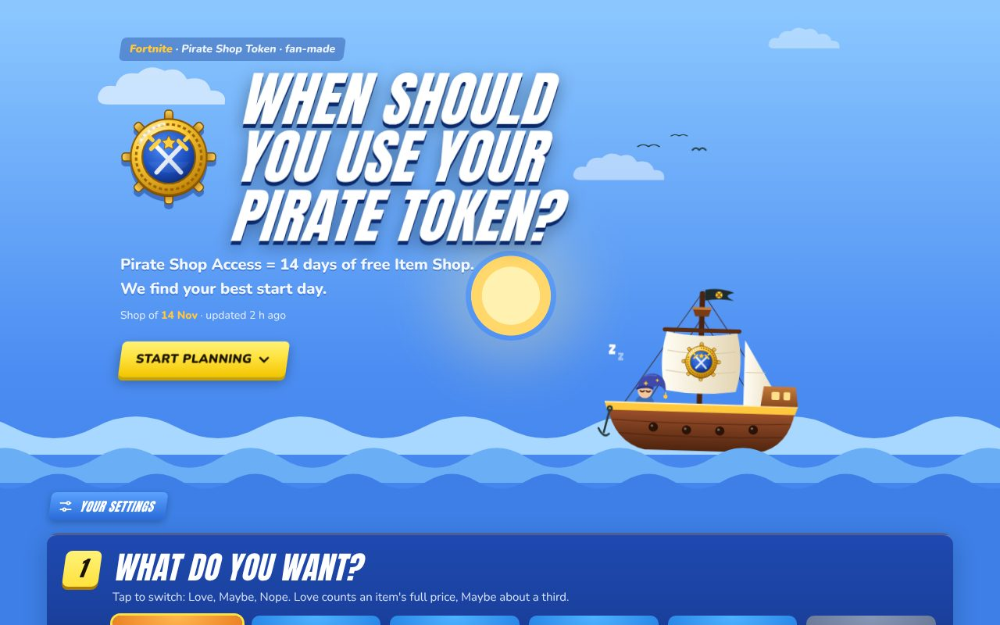
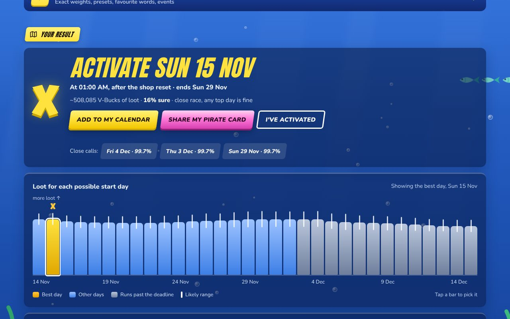
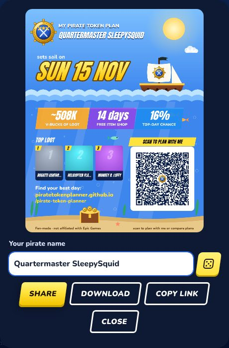

# Fortnite Pirate Shop Token Planner

**Found the Pirate Token? Find your best 14 days of free Item Shop.**

👉 **https://piratetokenplanner.github.io/pirate-token-planner/**

A free, fan-made web tool. Pirate Shop Access gives you 14 days of free V-Bucks items from the moment you press *Activate*. This page scores every possible start day against the live Item Shop and your own taste, and tells you when to activate.



## What it does
- **Tell it what you like:** Love / Maybe / Nope per item type, the days you play, favourite words and must-haves.
- **Best start day, with honest uncertainty:** 400 simulated futures give a likely range and a "how sure" score.
- **Live shop, updated every 6 hours,** plus about half a year of past shops to predict the days ahead.
- **Will it come back?** Search any skin and see how likely it is to return during your 14 days.
- **"I've activated" mode:** countdown, what leaves the shop today and tomorrow, and a claim checklist.
- **Pirate card:** a shareable picture of your plan with a QR code; friends can scan it, use your settings or compare plans.
- **Fully transparent:** every number, formula, source and limitation is shown on the page.
- Installable as an app, works offline, adapts to day and night.





## How it stays current
A GitHub Action (`.github/workflows/update.yml`) runs every 6 hours: it reads the Item Shop and in-game news from [fortnite-api.com](https://fortnite-api.com), imports past shops from the [Fortnite-Datamining](https://github.com/Fortnite-Datamining/Fortnite-Datamining) archive, re-checks every token rule and event against its sources, commits the data and redeploys GitHub Pages.

## How accurate is it

`scripts/backtest.py` replays the planner on the past-shop archive: from every day with 8+ weeks of history, it predicts the next 21 start days and compares with what really was in the shop. Results (May–Nov 2026, 105 start points):

| | Loot lost vs the truly best day |
|---|---|
| Current model | ~6% |
| Previous model | ~9–10% |
| Always activate on day 1 | ~9–10% |

The 10–90% range holds about 8 of 10 real outcomes; "% sure" (chance to land within 5% of the best start day) is a little optimistic. Events like a season launch are not part of the test, since the archive holds only one of each.

## Files
| Path | What |
|---|---|
| `index.html`, `style.css`, `app.js` | The page. All scoring is in `app.js` |
| `shared/normalize.js` | Shop parsing, used by the page and the updater |
| `scripts/update.mjs` | Data refresh, history import and source checks |
| `config/rules.json`, `config/events.json` | Token rules and expected events (edit these) |
| `data/` | Generated by the updater. Do not edit by hand |
| `fonts/`, `vendor/` | Self-hosted fonts and the QR code library |
| `tests/` | `node --test tests/*.test.mjs` |

## Run locally
```
node scripts/update.mjs            # fetch real data
python3 -m http.server 8000        # open http://localhost:8000/
```
Add `?today=2026-11-20` to simulate another date, `&time=night` for another time of day.

## Privacy
No cookies, no accounts, no tracking. Fonts and libraries are hosted here. A tiny anonymous counter ([Abacus](https://v2.jasoncameron.dev/abacus/)) counts visits and bell rings. Settings stay in your browser.

## Credits and licences
- Shop data: fortnite-api.com (unofficial), past shops: Fortnite-Datamining archive (ISC).
- Fonts: Nunito and Anton (SIL Open Font License), Luckiest Guy (Apache 2.0). QR codes: qrcode-generator by Kazuhiko Arase (MIT).

---
Portions of the materials used are trademarks and/or copyrighted works of Epic Games, Inc. All rights reserved by Epic. This material is not official and is not endorsed by Epic. Fan-made, provided as is, without warranty.
